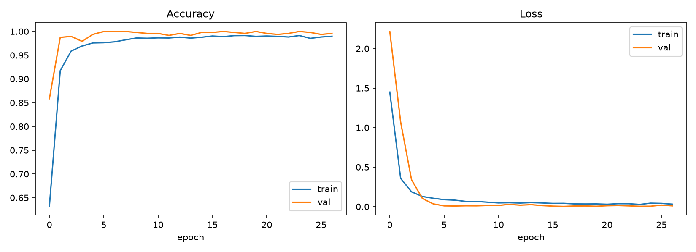
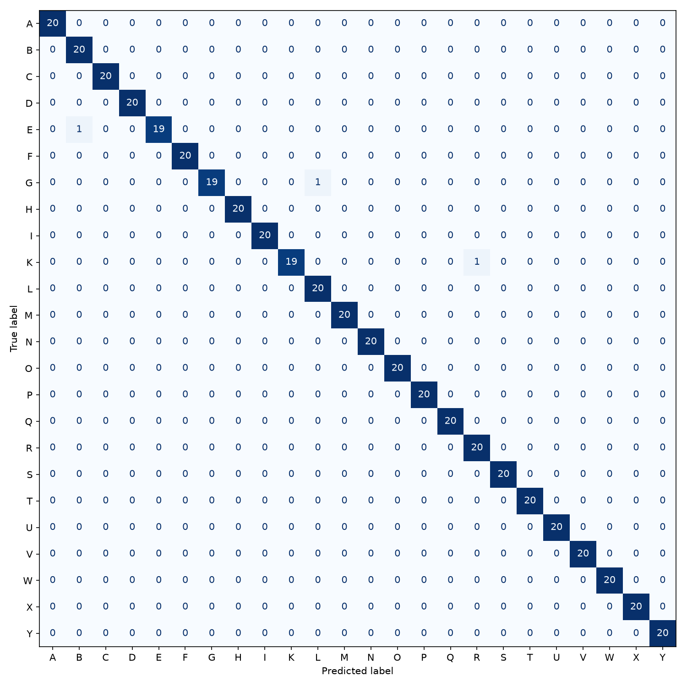

# SignSense: Real-Time American Sign Language (ASL) Recognition & Speech Synthesis

[](https://www.python.org/)
[](https://www.tensorflow.org/)
[](https://developers.google.com/mediapipe)
[](https://opencv.org/)
[]()
[](LICENSE)

**SignSense** is an end-to-end, real-time American Sign Language (ASL) fingerspelling recognition and translation system. Combining Google's MediaPipe Hands for high-frequency 3D hand landmark tracking with a custom Multilayer Perceptron (MLP) neural network built in TensorFlow/Keras, SignSense translates 24 static sign gestures into text and spoken audio in real time.

---

## Key Highlights

- **99.37% Test Accuracy**: Evaluated on 4,800 landmark samples across 24 alphabet classes.
- **Position & Scale Invariance**: Raw 63-dimensional coordinate vectors are translated to the wrist origin and normalized by the maximum hand span, allowing accurate recognition regardless of distance or hand size.
- **Smart Sentence Formation**: Temporal voting buffer (majority voting over sliding frames) eliminates flicker, paired with a hold-to-commit mechanic to compose words and sentences naturally.
- **Text-to-Speech (TTS) Integration**: Speak formed sentences aloud at any time with keyboard triggers via `pyttsx3`.
- **Lightweight & CPU-Friendly**: Real-time inference executes at 30+ FPS on standard laptop webcams without requiring a discrete GPU.

---

## System Architecture

```
                  ┌──────────────────────┐
                  │    Webcam Stream     │
                  └──────────┬───────────┘
                             │ (OpenCV)
                             ▼
                  ┌──────────────────────┐
                  │   MediaPipe Hands    │  ---> 21 3D Hand Landmarks
                  └──────────┬───────────┘
                             │
                             ▼
                  ┌──────────────────────┐
                  │ Feature Normalization│  ---> Wrist-relative origin shift
                  │ (Position & Scale)   │  ---> Max-distance scaling (63 features)
                  └──────────┬───────────┘
                             │
                             ▼
                  ┌──────────────────────┐
                  │      MLP Model       │  ---> Dense (128) + BatchNorm + Dropout
                  │  (TensorFlow/Keras)  │  ---> Dense (64) + Dropout -> Softmax (24)
                  └──────────┬───────────┘
                             │
                             ▼
                  ┌──────────────────────┐
                  │  Temporal Filtering  │  ---> Majority voting (deque window)
                  │  & Hold-to-Commit    │  ---> Confidence thresholding (>= 0.75)
                  └──────────┬───────────┘
                             │
              ┌──────────────┴──────────────┐
              ▼                             ▼
   ┌──────────────────────┐      ┌──────────────────────┐
   │ Real-Time HUD Text   │      │ Text-to-Speech (TTS) │
   └──────────────────────┘      └──────────────────────┘
```

---

## Supported Sign Alphabet

SignSense supports **24 static ASL letters**:

> `A`, `B`, `C`, `D`, `E`, `F`, `G`, `H`, `I`, `K`, `L`, `M`, `N`, `O`, `P`, `Q`, `R`, `S`, `T`, `U`, `V`, `W`, `X`, `Y`

*Note: Letters **J** and **Z** involve dynamic motion trajectories and are intentionally excluded from the static classifier.*

---

## Model Performance & Evaluation

The classification model achieved **99.37% test accuracy** on stratified held-out test data.

### Classification Report Summary

| Metric | Score |
| :--- | :--- |
| **Overall Accuracy** | **99.37%** |
| **Macro Average Precision** | **99%** |
| **Macro Average Recall** | **99%** |
| **Macro Average F1-Score** | **99%** |

### Training Progression & Confusion Matrix

| Training & Validation Curves | Confusion Matrix |
| :---: | :---: |
|  |  |

---

## Project Structure

```
SignSense/
├── data/
│   └── landmarks.csv          # 4,800 normalized landmark samples
├── models/
│   ├── signsense_mlp.keras    # Trained TensorFlow/Keras neural network
│   └── labels.json            # Target class labels mapping
├── results/
│   ├── confusion_matrix.png   # Model evaluation confusion matrix
│   ├── training_curves.png    # Loss and accuracy curves
│   └── report.txt             # Detailed classification metrics
├── collect_data.py            # Interactive CLI tool for collecting landmark data
├── live_predict.py            # Real-time webcam inference HUD and sentence builder
├── train.py                   # Data preprocessing, model training & evaluation
├── utils.py                   # Landmark flattening and geometric normalization
├── requirements.txt           # Python package dependencies
├── .gitignore                 # Standard exclusions for virtual environments and caches
├── LICENSE                    # MIT License
└── README.md                  # Project documentation
```

---

## Installation & Setup

### 1. Clone the Repository
```bash
git clone https://github.com/SpoorthiGTalanki/SignSense.git
cd SignSense
```

### 2. Create and Activate a Virtual Environment
```bash
# Windows
python -m venv .venv
.venv\Scripts\activate

# macOS / Linux
python3 -m venv .venv
source .venv/bin/activate
```

### 3. Install Dependencies
```bash
pip install -r requirements.txt
```

---

## Usage

### 1. Real-Time Translation (Live Demo)

Launch the interactive webcam inference interface:
```bash
python live_predict.py
```

#### Live Demo Controls
| Key | Action |
| :--- | :--- |
| **Hold sign steady (~1.5s)** | Appends the detected sign to the sentence buffer |
| `[SPACE]` | Inserts a space character |
| `[BACKSPACE]` | Deletes the last character |
| `[S]` | Speaks the accumulated sentence aloud using Text-to-Speech |
| `[C]` | Clears the entire sentence buffer |
| `[ESC]` | Exits the application |

---

### 2. Retraining the Model

To retrain the neural network on the dataset and regenerate evaluation metrics:
```bash
python train.py
```
This saves updated artifacts to `models/` and generates new performance plots in `results/`.

---

### 3. Collecting Custom Landmark Data

To record additional sign samples using your webcam:
```bash
# Record 200 samples per letter for person 'alice'
python collect_data.py --person alice --samples 200
```
- Press any letter key (`a`-`y`, except `j`) to begin recording landmarks for that sign.
- Press `[SPACE]` to pause.
- Press `[ESC]` to save and exit.

---

## Contributing

Contributions, issues, and feature requests are welcome! Feel free to check the [issues page](https://github.com/SpoorthiGTalanki/SignSense/issues).

1. Fork the Project
2. Create your Feature Branch (`git checkout -b feature/AmazingFeature`)
3. Commit your Changes (`git commit -m 'Add some AmazingFeature'`)
4. Push to the Branch (`git push origin feature/AmazingFeature`)
5. Open a Pull Request

---

## License

Distributed under the MIT License. See [`LICENSE`](LICENSE) for details.
